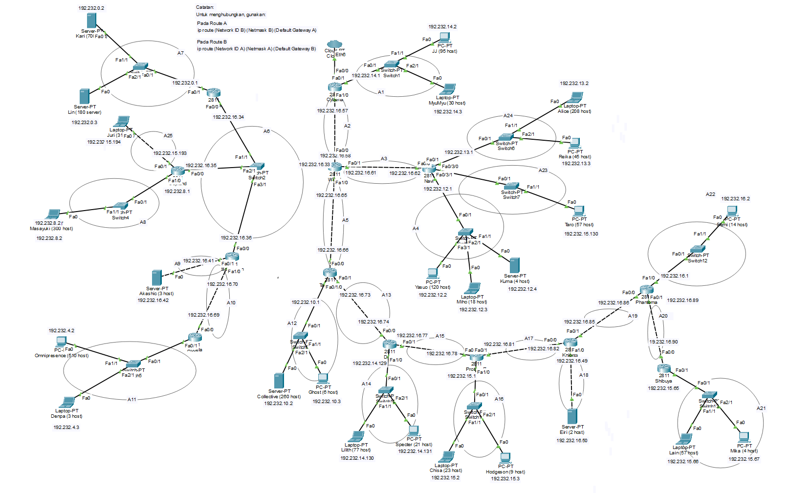
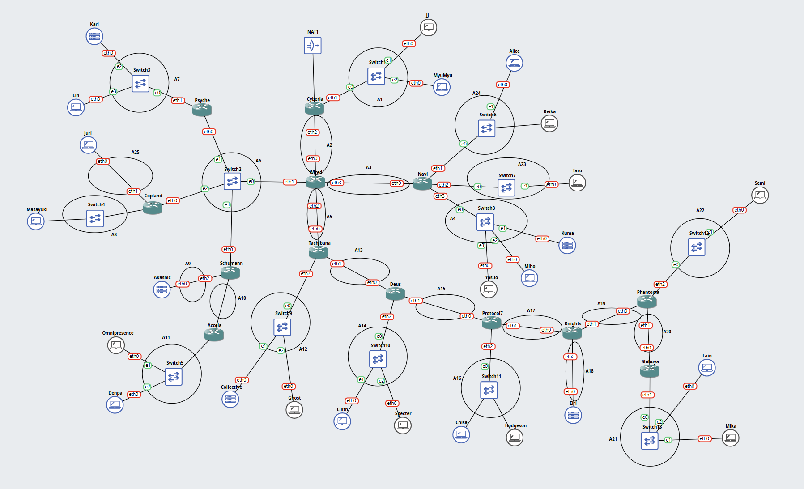

# Jarkom-Modul-4-2026-K-42

## Anggota

| | Nama | NRP |
| --- | --- | --- |
| 1 | Azita Zahwa Zahida Asmoro | 5027251058 |
| 2 | I Made Gyanendra Anand Wisnawa | 5027251072 |

## Laporan

[LINK SPREADSHEET]
[Spreadsheet_Perhitungan_IP_Address](https://docs.google.com/spreadsheets/d/1KNO8pKr-fQ73o9m3PeI0tCLzYzH6t3Ab/edit?usp=sharing&ouid=114067059484823198071&rtpof=true&sd=true)

### CPT - VLSM

1. Berikut merupakan topologi yang dibuat untuk Cisco Packet Tracer.

    

    Setelah dilakukan analisa terhadap topologi tersebut, dapat disimpulkan terdapat **25 subnet** yang perlu dilakukan.

2. Total Perhitungan Subnet

    Total subnet yang digunakan adalah **23 subnet** dimana total IP yang digunakan adalah **2815 IP**. Nilai IP tersebut menghasilkan subnet /20 yang memiliki IP *available* 4094 IP.

3. Static Routing

### GNS - CIDR

1. Topologi pada GNS3

    

2. Perhitungan IP (Subnetting)

3. Perhitungan IP dan Penggabungannya

4. Konfigurasi & Routing

5. Testing Koneksi (Ping)

